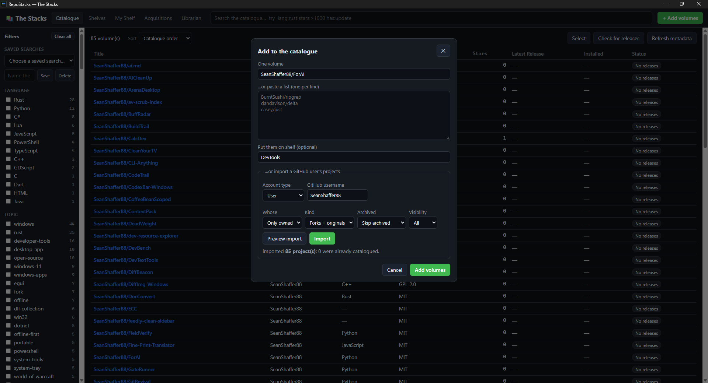
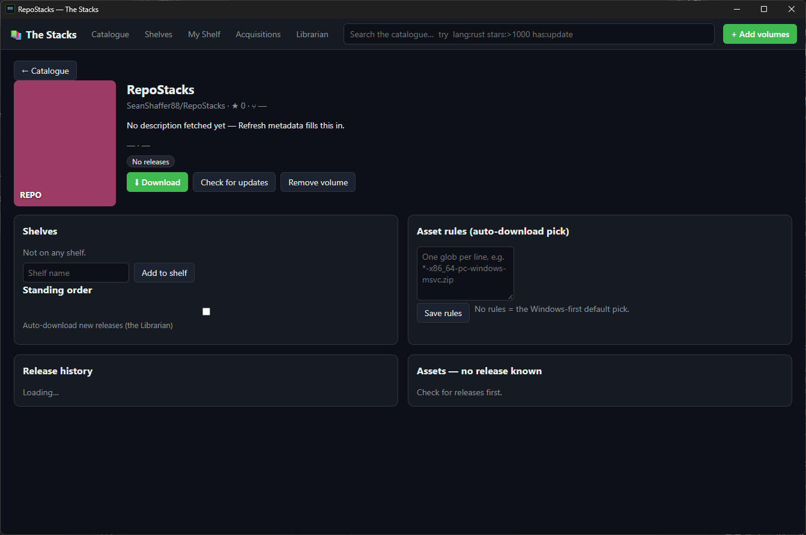

# RepoStacks

## TL;DR

RepoStacks is a library for your GitHub programs. Think of each repository as a
book: you keep the ones you care about on shelves, the app quietly watches for
new editions (releases), and when one appears it fetches the right copy for
your computer — all without needing a GitHub account.

## What it does

- **Catalogue** — add repositories by `owner/repo` or GitHub URL and browse
  them as volumes, with search and faceted filters (language, topic, license,
  stars, installed).
- **Shelves** — group volumes into collections; a repo can sit on many shelves.
- **Quota-free release watching** — new releases are detected from GitHub's
  public Atom feeds, which do not use the 60-requests-per-hour anonymous API
  limit. See `docs/ARCHITECTURE.md` for the corrected rate-limit design.
- **Downloads that land verified** — the engine picks the right file by the
  volume's glob rules or a Windows-first default, resumes interrupted downloads,
  and checks SHA-256 against the digest GitHub publishes before the file counts
  as installed. The Acquisitions queue persists across restarts.
- **The window** — a dark ledger desk for the library: faceted filter sidebar,
  four switchable layouts (ledger, card covers, compact list, shelf diagram),
  four themes, book-page volume details, and the Librarian — a built-in
  scheduler that checks the shelves on your interval and downloads standing
  orders automatically.
- **No login required** — everything above works with public data. An optional
  personal access token (stored protected by Windows DPAPI, never in plain
  text) raises the API limit and makes metadata refresh cheaper.

## Status

v0.2.0: the core library, command line, live network fetching, download engine,
and the window are built, with corruption-proof state files, parallel release
checks, retryable downloads, and an explainable auto-pick. The window has run
on a real Windows machine (2026-11-11): the catalogue and volume detail
screens render as designed — see Screenshots. Still unverified in the field:
the installer, token storage, downloads from the window, and the Librarian.

## Command line

Every capability is a command first. The command line ships as
`repostacks-cli.exe` (it sits beside `RepoStacks.exe`; the two names
differ only by letter case, which Windows treats as one filename).
Examples:

```text
repostacks-cli add rust-lang/rust
repostacks-cli shelf add "Dev Tools" rust-lang/rust
repostacks-cli list
repostacks-cli search compiler
repostacks-cli facets
repostacks-cli feed-url rust-lang/rust
repostacks-cli check-feed releases.atom
repostacks-cli match "*-win64.zip" app-win64.zip app.dmg
repostacks-cli updates
repostacks-cli find "lang:rust stars:>10000 sort:stars"
repostacks-cli check-all
repostacks-cli refresh --all
repostacks-cli download casey/just
repostacks-cli update-all
repostacks-cli queue list
repostacks-cli view layout cards
```

The window is the same library on a desk: run `RepoStacks.exe`, or build it
with `cargo build --release --features custom-protocol --manifest-path window/Cargo.toml`.

The catalogue lives in `data/catalog.json` (override with the `REPOSTACKS_DATA`
environment variable), carries a `schema_version`, and is written atomically
so a crash never loses it.

## Build

```text
cargo test
cargo build --release
```

## Screenshots

Real runs on Windows (v0.2.0, 2026-11-11):

The catalogue on first launch — an empty library, the filter panel (language,
topic, license, status), and the sort control:



A volume's book page — shelves, the standing-order toggle, per-volume asset
rules, release history, and the release's downloadable assets:



## License

MIT — see `LICENSE`.
